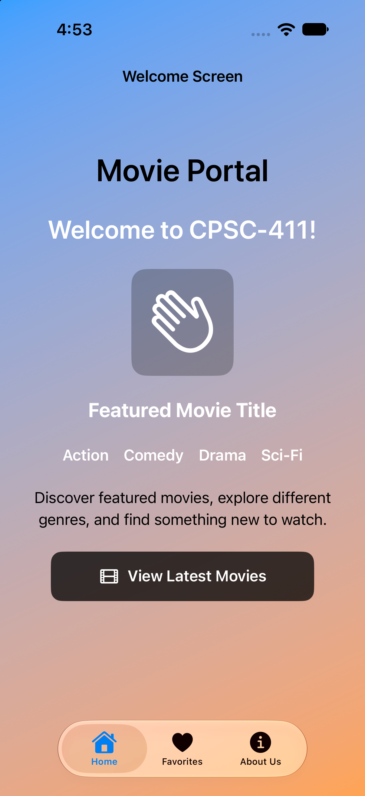
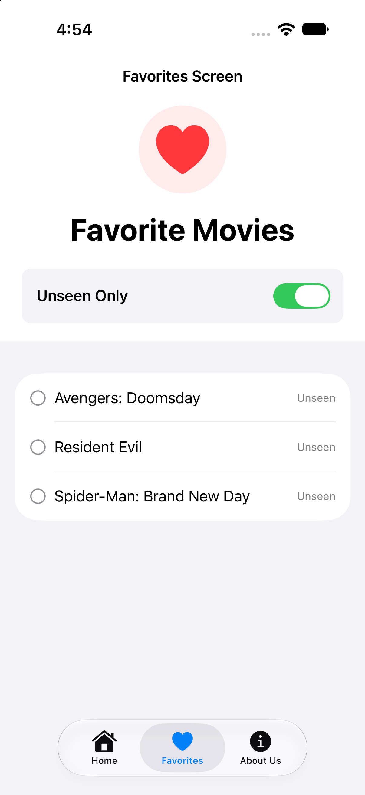
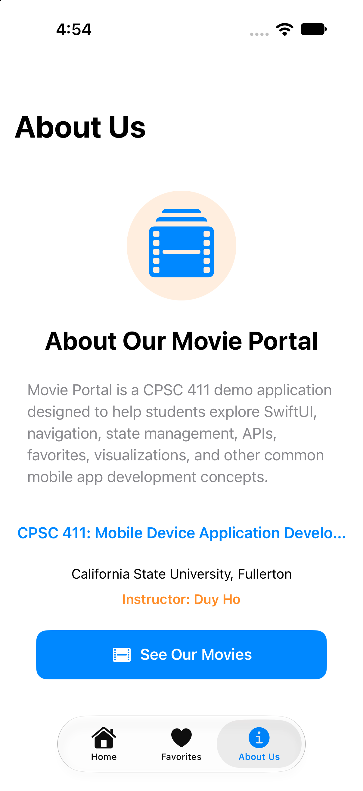

# CPSC 411 — Lab 03: SwiftUI Navigation and Multi-View Applications

## Goal

In this lab, you will explore multi-page navigation in SwiftUI using `TabView` and `NavigationStack`.

The starter project provides **3 completed views**:
1. **HomePage (`HomePageView.swift`)**: Includes header text, an icon (`house.fill`), and an interactive `Button`.
2. **AboutUs Page (`AboutUsView.swift`)**: Includes descriptive text, an icon (`person.3.fill`), and a `Link` button.
3. **Favorite Page (`FavoritesView.swift`)**: Includes title text, an icon (`heart.fill`), a `Toggle` switch, and a `List`.

Your goal is to implement **2 additional views** — **`LoginView`** and **`DashboardView`** — to bring the app to **5 total screens**.

---

## Starter Code - Demos

Below is the initial demo. You may vary your layout, design, and styling as long as the functional requirements are met.

<p align="left">
  
  
  
</p>

---

## 1. Clone and Open the Project

Clone your own Lab 03 repository and open `Navigation Basics.xcodeproj`.

Select an iPhone simulator and run the app using **Command + R**. To preview screens in Xcode, press **Option + Command + Return**.

---

## 2. Create the New SwiftUI View Files

You need to create two new SwiftUI View files in your Xcode project:

1. **`LoginView.swift`**
2. **`DashboardView.swift`**

### Steps to create a file in Xcode:
- Press **Cmd + N** (or select **File ➔ New ➔ File From Template...**).
- Choose **SwiftUI View** under the **iOS** category and click **Next**.
- Name the file (e.g., `LoginView` or `DashboardView`) and save it inside the project folder.

---

## 3. Design Requirements

Design each view separately until you see fit. Each view must fulfill the following design requirements:

### View 1: `LoginView.swift`
- **Icon**: At least one SF Symbol image (e.g., `Image(systemName: "person.circle.fill")` or `Image(systemName: "lock.shield")`).
- **Text**: Page title and descriptive text (e.g., header, instructions, or subheadings).
- **Required Component**: Must include a `TextField` for user input (e.g., username or email input).

### View 2: `DashboardView.swift`
- **Icon**: At least one SF Symbol image (e.g., `Image(systemName: "chart.bar.fill")` or `Image(systemName: "speedometer")`).
- **Text**: Title and metric/data descriptions.
- **Required Component**: Include at least one data or input UI control. You can use:
  - `Picker`
  - Dropdown menu (`Menu`)
  - Or choose from these recommended components:
    1. `ProgressView`
    2. `Slider`
    3. `Gauge`
    4. `Toggle`
    5. `Chart`

---

Before designing your new views, explore the built-in **Xcode Library** to discover available SwiftUI components.

1. Open a SwiftUI view file in Xcode.
2. Press **Shift + Command + L** or click the **+ (Library)** button in the upper-right corner.
3. Browse the available SwiftUI components, including `TextField`, `Button`, `Picker`, `Slider`, `Toggle`, `Gauge`, and `ProgressView`.
4. Drag components into your SwiftUI code to experiment with their appearance and behavior.
5. Use SwiftUI Previews to test and refine your design.

**Reference:** [1. Apple SwiftUI Documentation](https://developer.apple.com/documentation/swiftui) 
[2. Explore Swift UI](https://exploreswiftui.com/)

You are encouraged to experiment with different components and layouts. Your final implementation must satisfy the requirements for `LoginView` and `DashboardView`.

## 4. Step-by-Step Implementation Workflow

Follow these steps to complete the lab:

1. **Create & Test Separately**:
   - Create `LoginView.swift` and `DashboardView.swift`.
   - Build and test each view individually using SwiftUI Previews (`#Preview`) before connecting them to the rest of the app.

2. **Integrate with `NavigationStack`**:
   - Wrap the main content of `LoginView` and `DashboardView` in a `NavigationStack` and set a title using `.navigationTitle(...)`.

3. **Add to `ContentView.swift`**:
   - Open `ContentView.swift`.
   - Add both new views into the `TabView` so they appear alongside the first 3 instructor-provided screens (`HomePageView`, `FavoritesView`, and `AboutUsView`).

```swift
TabView {
    HomePageView()
        .tabItem {
            Label("Home", systemImage: "house.fill")
        }

    FavoritesView()
        .tabItem {
            Label("Favorites", systemImage: "heart.fill")
        }

    AboutUsView()
        .tabItem {
            Label("About Us", systemImage: "info.circle.fill")
        }

    // TODO: Add your LoginView here
    LoginView()
        .tabItem {
            Label("Login", systemImage: "person.fill")
        }

    // TODO: Add your DashboardView here
    DashboardView()
        .tabItem {
            Label("Dashboard", systemImage: "chart.bar.fill")
        }
}
```

---

## 5. Submission Checklist

- [ ] `LoginView.swift` created using **Cmd + N** or **File ➔ New ➔ File From Template...**
- [ ] `DashboardView.swift` created using **Cmd + N** or **File ➔ New ➔ File From Template...**
- [ ] Both views tested separately using SwiftUI Previews before full integration.
- [ ] Both views wrapped in a `NavigationStack` with `.navigationTitle(...)`.
- [ ] `LoginView` contains an icon (`Image(systemName: ...)`), text, and a `TextField`.
- [ ] `DashboardView` contains an icon, text, and an interactive UI control (`Picker`, `Menu`, `ProgressView`, `Slider`, `Gauge`, `Toggle`, or `Chart`).
- [ ] Both views added to `ContentView.swift` inside `TabView` to complete 5 navigation tabs.
- [ ] Changes committed and pushed to GitHub.

### Expected Demo

https://github.com/user-attachments/assets/a31f6ee3-d5b3-41da-9d4b-464cc8fed152
